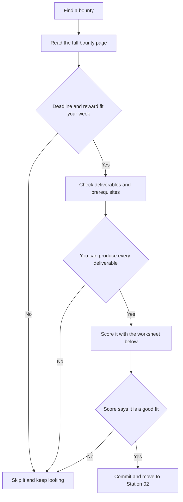
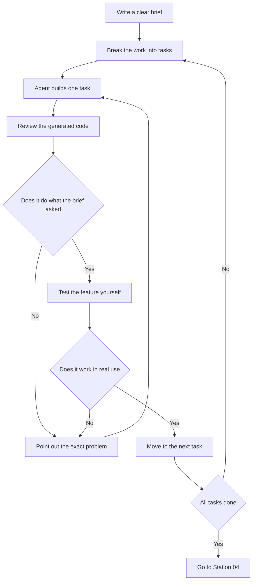
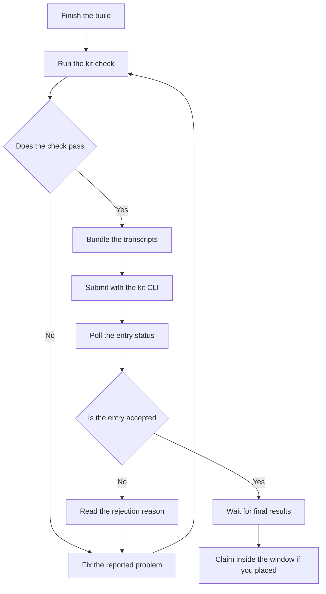

# THE BOUNTY WORKSHOP

**Turn AI Ideas Into Competition-Ready Builds.**

[](https://make.fun/bounty/bring-the-humans-02)
[](https://make.fun/bounty/bring-the-humans-02/leaderboard)
[](https://make.fun/bounty/bring-the-humans-02)

AI can write the code. But choosing the right opportunity, understanding the rules, directing the agent, testing the result, and submitting a valid entry are skills you still need to develop. This workshop helps you develop those skills. Learn the complete process of participating in make.fun coding competitions, from your first bounty discovery to your final submission.

This repository is a practical field manual. It shows you how to discover coding opportunities, understand technical requirements, build with AI agents, validate your work, and submit professional bounty entries. It is a workshop, not a promise of income. Rewards go only to entries that place in the positions a bounty lists, and most entries earn nothing. What this guide gives you is a repeatable process, so every entry you submit is a genuine attempt instead of a guess.

> **Start here:** <https://make.fun/r/2pd6m625> — referral code `2pd6m625`.
>
> Disclosure: this is my referral link. make.fun may reward me when eligible referred users participate. It costs you nothing extra, and using it does not change your chances in any competition. You can also visit make.fun directly without a referral link.

## Contents

- [How to Use This Workshop](#how-to-use-this-workshop)
- [How to Read This Guide](#how-to-read-this-guide)
- [Station 01 SCOUT](#station-01-scout)
- [Station 02 SPEC](#station-02-spec)
- [Station 03 BUILD](#station-03-build)
- [Station 04 VERIFY](#station-04-verify)
- [Station 05 SHIP](#station-05-ship)
- [Station 06 IMPROVE](#station-06-improve)
- [Bounty Readiness Scorecard](#bounty-readiness-scorecard)
- [Agent Prompt Workbench](#agent-prompt-workbench)
- [Submission Failure Library](#submission-failure-library)
- [Builder Glossary](#builder-glossary)
- [Project Quality Rubric](#project-quality-rubric)
- [First Build Exercise](#first-build-exercise)
- [Official Facts for This Competition](#official-facts-for-this-competition)
- [Frequently Asked Questions](#frequently-asked-questions)
- [Start Here](#start-here)

## How to Use This Workshop

This guide is built as six stations. Work through them in order the first time. After that, return to whichever station matches the step you are on.

| Station | Question it answers | Output you should have |
| --- | --- | --- |
| 01 SCOUT | Which bounty is worth my time? | One chosen bounty and a filled evaluation worksheet |
| 02 SPEC | What exactly must I deliver? | A task plan derived from the real requirements |
| 03 BUILD | How do I get an AI agent to build it well? | Working code, reviewed and tested task by task |
| 04 VERIFY | Is my entry actually ready? | A completed pre-submission audit |
| 05 SHIP | How do I submit without breaking the rules? | A valid submitted entry and a known status |
| 06 IMPROVE | What do I do with the result? | A next step, whether you placed or not |

**Who this is for.** Builders who can use an AI coding agent but have never entered a coding competition, and builders who have entered before and want fewer rejected submissions. You do not need to be a professional programmer. You do need patience: reading requirements carefully is half the work.

**What you need before Station 01.** A GitHub account, a way to run an AI coding agent, and a make.fun account with your GitHub account linked to it. Linking GitHub is a platform prerequisite for submitting an entry; without it, the submission step cannot work.

**What this workshop is not.** It is not financial advice, not a shortcut to guaranteed earnings, and not an official make.fun publication. It is an independent community guide written by a participant, based on the platform's public documentation and the official competition kit. Where a statement comes from the platform itself, this guide labels it as an official fact. Where it is the author's judgement, it is labeled as a recommendation. Platform rules change; when this guide and the live bounty page disagree, the live bounty page wins.

> **Join make.fun:** <https://make.fun/r/2pd6m625> — referral code `2pd6m625`.
>
> Disclosure: this is my referral link. make.fun may reward me when eligible referred users participate. There is no promised amount and no promised income; current referral reward values are published by the platform, not by this guide.

## How to Read This Guide

Every claim in this guide carries one of three labels, so you always know what kind of statement you are reading.

- **Official fact.** Verified against make.fun's public documentation, the competition API, or the official kit. Example: an entry deadline, a prize table, a required file name. Treat these as rules.
- **General advice.** Widely useful practice for building and shipping software. It is not platform-specific and it is not a rule. Example: breaking work into small tasks before asking an agent to build.
- **Our recommendation.** The author's judgement about the better way to do something, based on experience with these competitions. You may disagree. Example: preferring a smaller first bounty over a large one.

Two more habits will save you more time than any tool in this guide. First, read the whole bounty page before you write a line of code. Second, never trust a claim about a reward, a deadline, or a rule that you have not seen on the live bounty page or in the official kit. Screenshots and second-hand summaries go stale; the live page is the source of truth.

## Station 01 SCOUT

**Goal:** choose one bounty you can realistically finish before its deadline.

### What make.fun is

> **Official fact:** make.fun runs coding competitions, called bounties, in which participants build software with AI agents and submit entries for grading. Each bounty lists its own prize pool, deadline, deliverables, and grading criteria. This repository was written for the bounty `bring-the-humans-02`, "Bring the humans again".

A bounty is not a job posting and not a lottery ticket. It is a time-boxed build with published rules. Your entry is judged against the criteria the bounty lists, not against other entries' marketing. That is good news: you are competing on the quality of a defined deliverable, and the definition is public before you start.

### How bounties work

1. You find a bounty and read its full page: prize, deadline, deliverables, grading criteria, prerequisites.
2. You build the deliverable, usually in a public GitHub repository, with the help of an AI agent.
3. You bundle the genuine record of your agent sessions with the official kit and submit.
4. The platform checks your entry, grades it, and publishes rankings.
5. If your entry places in a paid position, you claim the reward through the official claim flow.

### Compare opportunities before you commit

Do not pick the biggest prize pool. Pick the bounty whose deadline, deliverables, and prerequisites fit the time and skills you actually have this week. Compare candidates side by side:

| Factor | What to check | Why it matters |
| --- | --- | --- |
| Deadline | Days left, in your own timezone | A bounty you cannot finish is a wasted entry slot |
| Prize places | How many positions are paid, and what each pays | Only listed positions are paid; an entry outside them earns nothing |
| Deliverables | Files, formats, and sizes required | A deliverable you cannot produce is a blocker, not a challenge |
| Grading criteria | What the grader actually scores | Building the wrong thing well still scores badly |
| Prerequisites | Linked accounts, wallets, tools, fees | A missing prerequisite found on day one is cheap; found at submission time, it is fatal |
| Entry fee | Free, or a fee you must pay | A fee changes the risk calculation; never pay one you did not budget for |
| Your fit | Have you built anything like this before? | A first bounty should teach you the process, not test your limits |

### The evaluation process



### Opportunity evaluation worksheet

Copy this table, fill one row per candidate bounty, and pick the highest honest score, not the highest prize.

| Question | Your answer |
| --- | --- |
| Bounty name and link | |
| Entries close on (date and time, your timezone) | |
| Days you can actually work on it | |
| Prize pool and number of paid positions | |
| Deliverables required | |
| Grading criteria, in your own words | |
| Prerequisites you already meet | |
| Prerequisites you still need | |
| Entry fee, if any | |
| Similar things you have built before | |
| Biggest risk to finishing on time | |
| Decision: pursue, watch, or skip | |

> **Our recommendation:** for a first bounty, choose the smallest deliverable you can finish in half the time available. Finishing early leaves room for the verification station, which is where most first entries are saved from rejection. A large bounty finished late is worse than a small bounty submitted cleanly.

Before you move on, run the [Bounty Readiness Scorecard](#bounty-readiness-scorecard). If your score says you are not ready, fix the gap first. It is cheaper than discovering it at submission time.

## Station 02 SPEC

**Goal:** turn the bounty page into a task plan you can actually build from. No code yet.

### Read the bounty page like a contract

> **Official fact:** for `bring-the-humans-02`, the required deliverables are a public repository URL owned by the GitHub account linked to your make.fun account, a full 40-character commit SHA, a transcript bundle produced by the official kit, an optional title of at most 200 characters, and a signed entry message with an entry signature. The signature must be made within 10 minutes of submission, using Ed25519, by a wallet on your account.

That paragraph is the whole submission. Everything else on the bounty page tells you what the repository must contain and how it will be graded. Read it twice: once for the shape of the deliverable, once for the details you will miss the first time.

### What to extract

- **Deliverables.** Every file, format, and size limit. For a guide-style bounty this typically includes a `README.md` at the repository root and a `screenshot.png` at the repository root. Note the exact file names; a near-miss is a miss.
- **Required files.** Which files must exist, where they must sit, and what must be inside them. Note anything that must not exist, such as a second README in a location that would shadow the root one.
- **Grading criteria.** The exact scoring rules, quoted or paraphrased faithfully. These decide what "good" means for this bounty. Build to them, not to your own taste.
- **Prerequisites.** Accounts to link, tools to install, wallets to connect, licenses to include. Confirm each one before building.
- **Rules and limits.** Entry quotas, deadlines, claim windows, and anything that disqualifies an entry. Quotas apply per account and refused attempts can count against them, so do not submit to "test" the system.

### Requirement-analysis template

Fill one row per requirement. If a row has no answer, you have not finished reading.

| Requirement | Type | What it means in practice | Done |
| --- | --- | --- | --- |
| | Deliverable / File / Rule / Prerequisite | | |
| | Deliverable / File / Rule / Prerequisite | | |
| | Deliverable / File / Rule / Prerequisite | | |
| | Deliverable / File / Rule / Prerequisite | | |

### From requirements to a task plan

Group the requirements into build tasks of one clear outcome each. A task should be small enough that you can describe its done-state in one sentence: "the README explains all six stations", not "write the guide". Order the tasks so that the riskiest or least familiar one comes first, while you still have time to recover. Write the plan down before opening your agent. A plan you can point at is the difference between directing an agent and watching one wander.

> **General advice:** if two requirements conflict, or a requirement is genuinely unclear, stop and re-read the bounty page and the kit documentation. Do not guess and build. A question answered late costs a rebuild; a question answered early costs a minute.

## Station 03 BUILD

**Goal:** produce working software by directing an AI agent in small, reviewed steps.

### Prepare the environment first

Set up the repository, the toolchain, and the test command before asking the agent to build anything. Confirm the project runs empty: a blank page that loads, a test suite that passes with zero tests, a build that succeeds. If the empty project does not work, the agent will spend its effort fighting your setup instead of building your idea.

### Give clear instructions

An agent is only as good as its brief. A good brief names the outcome, the constraints, and the definition of done. A bad brief names a vibe. Compare:

- Weak: "make it look nice and modern."
- Strong: "Build a single static page with a header, a three-column feature section, and a footer. Use no JavaScript framework. The page must load with no console errors and pass the checks in Station 04."

Write the brief yourself, in your own words, before the agent starts. If you cannot describe the outcome, you cannot judge whether the agent delivered it.

### Break the work into tasks

Feed the agent one task at a time, in the order from your Station 02 plan. After each task, review the result before starting the next one. This is slower per task and much faster per project, because errors are caught while they are still small and local.



### Review generated code like it is yours

It is yours. You are submitting it, so you own its bugs, its licenses, and its security. Read the diff of every task. Check for:

- Code that does something the brief never asked for, especially network calls, payments, or credential handling.
- Copied code with a license you have not checked. If a file's license is unclear, do not ship it.
- Placeholder content, fake data, or hardcoded values presented as real.
- Dependencies you do not recognise. Look each one up before you keep it.

> **General advice:** if you cannot explain what a generated file does, do not submit it yet. Ask the agent to explain it, or remove it. "The agent wrote it" is not a defence in a review, and it is not a defence to a grader either.

### Improve weak results instead of restarting

When a task comes back wrong, do not delete everything and start over. Describe the exact gap: what you expected, what you got, and what is wrong in one sentence each. Give the agent that description plus the smallest failing example you can produce. Most weak results improve in one or two focused rounds. If the same task fails three focused rounds, the brief is probably the problem, not the agent. Rewrite the brief, make the task smaller, and try again.

### A professional AI-builder prompt

Use this as the starting brief for a build session. Fill in the bracketed parts for your bounty, then keep it as the first message of the session so the agent works from the same instructions throughout.

```text
You are my build partner for a make.fun bounty entry.

Bounty: [name and link]
Deliverable: [what must exist when we finish, in one sentence]
Constraints: [stack, file layout, things that are forbidden]

Working rules:
1. Work one task at a time, in the order I give you.
2. After each task, stop and wait for my review. Do not start the next task.
3. Do not add features, dependencies, or network calls I did not ask for.
4. Do not invent data, statistics, or quotes. If a fact is needed, ask me or
   leave a clearly marked TODO with the source that must confirm it.
5. Keep every file licensed and attributed correctly. Flag any code you are
   unsure about instead of silently including it.

Definition of done for each task:
- The feature works when I test it by hand.
- No console errors, no broken links, no placeholder content.
- You can explain every file you changed, in two sentences or fewer.

We start with task 1: [first task from the Station 02 plan].
```

The full set of reusable prompts lives in the [Agent Prompt Workbench](#agent-prompt-workbench).

## Station 04 VERIFY

**Goal:** prove the entry is ready, with evidence, before anyone else looks at it.

Verification is where good builds become valid submissions. Most rejected entries were never checked by their own author. Run every check below and record the result. A check you skipped is a check the grader will run for you, with worse timing.

### The verification list

- **Run the tests.** Whatever test command the project has, run it from a clean state and confirm it passes. If the project has no tests, run the build and the manual smoke test instead, and write down what you tested.
- **Check the GitHub repository.** Open the public repository in a browser, logged out if you can. Confirm the files are at the paths the bounty requires, the default branch is the one you will submit, and the commit you plan to submit is pushed.
- **Review the commit history.** The history should show real work in sensible steps. The bundle you submit will contain the actual agent sessions, so the history and the sessions should agree with each other. Do not rewrite history to hide mistakes; a clean, honest history is worth more than a perfect-looking one.
- **Check licenses.** Confirm the repository license is an OSI-approved license, such as MIT, and that any third-party code you included keeps its own license and attribution. A missing or incompatible license can fail an entry outright.
- **Capture actual screenshots.** Take screenshots of the real, working result, not of mockups or of a design tool. The screenshot must show what the deliverable genuinely does. For this bounty the repository root needs a real `screenshot.png` of the guide as rendered.
- **Bundle genuine agent sessions.** The submission bundle must contain the real transcripts of the sessions that built the entry. Do not fabricate, edit, or substitute transcripts. A bundle that does not match the work is worse than no bundle.
- **Run local grading where supported.** If the bounty or its kit offers a local check, run it. It exists to catch the failures that would otherwise cost you an entry slot.

### Pre-submission audit worksheet

Check every row. Any row you cannot check honestly is a reason to stop and fix it, not a reason to submit anyway.

| Check | How to confirm | Result |
| --- | --- | --- |
| Repository is public | Open the URL logged out | |
| Commit SHA is the full 40 characters | Copy it from the pushed commit | |
| Commit is on the default branch | Check the branch on GitHub | |
| README is at the repository root | Open it at the root path | |
| README is within the size limit | Check the file size | |
| Required referral link or code is present | Search the README for it | |
| screenshot.png is at the repository root | Open it at the root path | |
| Screenshot shows the real result | Look at it with fresh eyes | |
| LICENSE is present and OSI-approved | Read the license file | |
| No shadowing README exists | Confirm no second README overrides the root one | |
| Tests or build pass from clean state | Run them and record the output | |
| Kit check passes | Run the official check, see Station 05 | |
| Bundle contains genuine sessions | Confirm the transcripts match your real work | |

Also score the entry against the [Project Quality Rubric](#project-quality-rubric). If a dimension scores weak, fix it now, while fixing is still cheap.

## Station 05 SHIP

**Goal:** submit a valid entry through the official workflow, then track it honestly.

> **Official fact:** submissions for make.fun bounties go through the official kit CLI. The commands below come from the kit documentation for this competition. Run them from inside the unpacked kit directory.

### The submission workflow

**1. Download the kit.**

```sh
curl -sSL "https://make.fun/c/bring-the-humans-02/kit" | tar xz
```

**2. Bundle your agent sessions.**

```sh
node cli/makefun.mjs bundle
```

This produces the transcript bundle (`.tar.gz`) that proves the entry was genuinely built with an agent. Bundle the real sessions, from the real work.

**3. Run the official check.**

```sh
node cli/makefun.mjs check --repo <repo-path> --transcripts <bundle-file>
```

Fix every failure it reports before you submit. A failed check at this step is free. A failed check after submission costs you an entry attempt, and refused attempts can count against your daily quota.

**4. Submit.**

```sh
node cli/makefun.mjs submit --competition bring-the-humans-02 --repo-url <url> --commit <sha> --title <name> --bundle <file> --keypair <file>
```

The commit SHA must be the full 40 characters, from the pushed commit on the public repository owned by your linked GitHub account. The title is optional and at most 200 characters. The keypair signs the entry message; the signature is only valid for 10 minutes, so submit promptly after signing.

**5. Poll the status.**

```sh
node cli/makefun.mjs status --submission <submission-id>
```

Keep the submission ID. Check the status until it shows accepted or rejected, and read the reason either way.

**6. Claim, if you placed.**

```sh
node cli/makefun.mjs claim --claim <claim-id> --keypair <file> --us-person <yes|no>
```

> **Official fact:** the claim deadline is set once the result is posted. Check the bounty page after results are announced and claim inside the window.



### If the submission is rejected

Read the rejection reason before doing anything else. Most rejections name the exact problem: a missing file, a wrong path, a signature that expired, a quota already used. Fix that problem, re-run the kit check, and submit again only if you still have quota. The [Submission Failure Library](#submission-failure-library) lists the common cases and their fixes.

> **Official fact:** the entry quota for this competition is 5 submissions per day and 20 in total per account, and refused attempts count toward the daily quota. Never submit to "test" the system. Test with the kit check instead; that is what it is for.

### Entry status, honestly tracked

Keep a short log for yourself: submission ID, commit SHA, date, status, and any rejection reason. When the provisional ranking appears, remember it is provisional. Rankings can change before the final result, and only the final result decides the paid positions. Do not announce a win before the final result is posted.

## Station 06 IMPROVE

**Goal:** turn one entry, placed or not, into a better next entry.

### Learn from grader feedback

Read the result, the ranking, and any feedback the platform gives, then write down three things: what scored well, what scored badly, and what you would change with one more day. Do this while the work is fresh. A month later you will remember the feeling and forget the facts.

### Improve quality, not volume

One strong entry teaches you more than three rushed ones, and it costs fewer quota slots. Before starting the next bounty, pick the single weakest dimension from the [Project Quality Rubric](#project-quality-rubric) and make it the explicit goal of the next build. If reliability was weak, add tests. If completeness was weak, cut scope earlier. If originality was weak, spend longer on the idea before building.

### Provisional versus final rankings

> **Official fact:** for this competition the final window opens when entries close, and the result is due 6 Dec 2026 16:30 UTC. Rankings shown before the final result are provisional and can change.

Treat a provisional position as information, not as income. Do not spend money you have not claimed, and do not promise anyone a result that is not final.

### Build a public portfolio

Your submitted repositories are public. Over time they become the honest record of your work: what you built, how you built it, and what you learned. Keep them tidy, keep their READMEs accurate, and link them from a single place people can find. A portfolio of finished, verifiable work is worth more than a list of competitions you entered.

### Join developer communities

Find the communities where other builders discuss these competitions, share what worked, and ask for review before you submit. A second pair of eyes on a README or a submission check catches the mistake you have read past ten times. Contribute back: answer a question, review an entry, share a failure and its fix. The builders who improve fastest are usually the ones who let other people see their work early.

### Evaluate new opportunities

When a new bounty appears, go back to Station 01. Do not chase every new competition. A new bounty is only worth your time if it passes the same evaluation worksheet and scorecard as the last one. The discipline is the same every time; that is the point of a workshop.

> **Our recommendation:** after each competition, take one day off building and spend it reading the top entries. Study what the strongest entries did differently: their structure, their evidence, their clarity. Then write down the three differences you can copy honestly in your next build. No guaranteed earnings come with any of this, in this competition or any other. The reward for doing the process well is a better entry, and a better entry is the only thing that can place.

## Bounty Readiness Scorecard

Score yourself honestly before you commit to a bounty. Give 2 points for yes, 1 for partly, 0 for no.

| # | Check | Points |
| --- | --- | --- |
| 1 | I have read the full bounty page, including deliverables and grading criteria | 0 / 1 / 2 |
| 2 | The deadline leaves time for build, verify, and submit, with a day to spare | 0 / 1 / 2 |
| 3 | I can produce every required deliverable with tools I already have | 0 / 1 / 2 |
| 4 | My GitHub account is linked and my repository can be public | 0 / 1 / 2 |
| 5 | I have an AI agent I can use for the whole build | 0 / 1 / 2 |
| 6 | I have enough uninterrupted work time before the deadline | 0 / 1 / 2 |
| 7 | I understand how the entry is scored and what "good" means here | 0 / 1 / 2 |
| 8 | I have a plan for the submission step, including the kit and the keypair | 0 / 1 / 2 |
| | **Total (max 16)** | **/ 16** |

| Total | What it means |
| --- | --- |
| 13–16 | Ready. Commit and start Station 02. |
| 8–12 | Ready with gaps. Fix the zero-point rows first, then commit. |
| 0–7 | Not ready. Pick a smaller bounty or a later one, and use the time to close the gaps. |

## Agent Prompt Workbench

Six reusable prompts. Each one is written to be copied as-is and filled in at the bracketed parts. They are templates, not magic: a prompt cannot fix a brief you have not thought through.

### 1. Requirement analysis

```text
Read the bounty page at [link] and the requirements file at [path].
List every deliverable, every required file, every grading criterion,
and every rule or limit, each on its own line.
For each item, write one sentence explaining what it means for the build.
Then list anything that is unclear or contradictory, and do not guess at it.
End with a short summary: what must exist for this entry to be valid.
```

### 2. Project planning

```text
Here are the requirements: [paste the Station 02 output].
Break the build into tasks of one clear outcome each.
For each task, state the outcome, the files it touches, and how I will know
it is done. Order the tasks so the riskiest or least familiar comes first.
Flag any task that depends on something I have not confirmed yet.
Keep the whole plan short enough to read in two minutes.
```

### 3. Feature implementation

```text
Build this one task and nothing else: [task from the plan].
Outcome: [one sentence]. Files to change: [list].
Constraints: [stack, style, things that are forbidden].
When you finish, stop and wait for my review.
Then list the files you changed and, for each one, one sentence saying
what it does. Do not add features, dependencies, or network calls
I did not ask for.
```

### 4. Code review

```text
Review the changes in [files or commit range] as if you were the grader.
Check for: bugs, dead code, placeholder content, hardcoded fake data,
missing error handling, unclear licenses, and anything the brief did not
ask for. For each problem, give the file and line, one sentence explaining
why it matters, and the smallest fix you suggest. Do not rewrite the code
yet; report first, and wait for me to choose the fixes.
```

### 5. Bug fixing

```text
This is broken: [what you expected, what actually happened].
Reproduce it with: [steps, input, or command].
The smallest failing example is: [paste it].
Find the root cause, explain it in two sentences, and fix only that cause.
Do not refactor unrelated code. After the fix, tell me how to verify it
in one command or one manual check.
```

### 6. Final submission audit

```text
Audit this repository against the bounty requirements at [link].
Check: every required file exists at the right path, the README is at the
root and within the size limit, the referral link or code is present,
the screenshot shows the real result, the license is OSI-approved,
and there is no second README that could shadow the root one.
Report each check as PASS or FAIL with the evidence you used.
For every FAIL, give the exact fix. Do not submit anything.
```

## Submission Failure Library

Common submission problems, why they happen, and the fix. If your rejection reason is not listed here, read the exact message the platform returned and fix what it names.

| Problem | Why it happens | Fix |
| --- | --- | --- |
| README is missing the referral link or code | The guide-page check requires your own referral link or 8-character code in the root README | Add the link as `/r/<code>` or `?ref=<code>` and re-run the kit check |
| A second README shadows the root one | A `.github/README.md` overrides the root README in the check | Remove the shadowing README and keep only the root one |
| screenshot.png is missing or too large | The file is absent, not at the root, or over the size and pixel limits | Place a real screenshot at the root, within 8 MB and 16,000,000 pixels |
| Bundle is missing or incomplete | The transcript bundle was not produced, or it does not contain the genuine sessions | Re-run the kit bundle step on the real sessions and submit the new file |
| Commit SHA is wrong or not pushed | A short hash was used, or the commit exists only locally | Push the commit and submit the full 40-character SHA from the pushed commit |
| Title is too long | The title exceeds 200 characters | Shorten it to 200 characters or fewer |
| Signature expired or wrong wallet | More than 10 minutes passed after signing, or the signing wallet is not on the account | Sign again immediately before submitting, with a wallet on the account |
| Quota already used | 5 submissions per day or 20 in total were already spent, including refused attempts | Wait for the next day, or stop; do not burn attempts testing |
| LICENSE missing or not approved | No license file, or a license that is not OSI-approved, at the submitted commit | Add an OSI-approved license such as MIT and submit the new commit |
| Repository is private or not yours | The repository is private, or it belongs to a GitHub account that is not linked | Make the repository public under the linked GitHub account |

## Builder Glossary

Plain-language definitions for the words this guide uses. When the platform uses a word differently, the platform's meaning wins.

| Term | Meaning |
| --- | --- |
| Bounty | A time-boxed coding competition with published rules, deliverables, and prizes |
| Deliverable | A file or artefact the bounty requires you to produce and submit |
| Entry | One submitted attempt at a bounty, tied to a repository, a commit, and a bundle |
| Submission | The act of sending an entry to the platform, and the record it creates |
| Commit SHA | The unique 40-character identifier of one commit in a Git repository |
| Bundle | A compressed archive of the agent session transcripts that built the entry |
| Transcript | The genuine record of one working session with an AI agent |
| Keypair | The cryptographic key files used to sign the entry message |
| Ed25519 | The signature scheme the platform uses for entry messages |
| Escrow | Funds held by the platform so prizes can be paid out when results are final |
| Leaderboard | The ranked list of entries for a bounty |
| Provisional ranking | A ranking shown before the final result; it can still change |
| Final ranking | The confirmed ranking that decides which entries are paid |
| Claim | The official step that moves a won reward to the winner |
| Referral link | A personal link that attributes new sign-ups to the person who shared it |
| Quota | The maximum number of submissions allowed, per day and in total |
| Grading criteria | The published rules that decide how an entry is scored |
| Harness | The competition's technical setup: how entries are checked, graded, and ranked |

## Project Quality Rubric

Score your entry in each dimension before you submit. A dimension that scores weak is a fix, not a footnote.

| Dimension | Strong | Adequate | Weak |
| --- | --- | --- | --- |
| Usability | A stranger can use it in minutes with no help | Usable with the README open beside it | Confusing, broken, or unexplained |
| Completeness | Every required deliverable exists and works | All deliverables exist; one or two are thin | A deliverable is missing or does not work |
| Reliability | Tests or a clean build pass; no errors in normal use | Works in the tested path; untested edges | Crashes, errors, or fails to build |
| Originality | A clear idea of your own, executed with care | Competent work on a familiar idea | Copied, generic, or assembled without thought |
| Compliance | Meets every stated rule, file, size, and license requirement | Meets the rules with minor gaps | Breaks a stated rule or omits a requirement |

> **Our recommendation:** an entry that is strong on compliance and completeness will beat a clever entry that fails a file check. The grader can only score what was validly submitted. Fix compliance first, then completeness, then the rest.

## First Build Exercise

A small practice run through the whole workshop, in about two hours, on a local practice repository. It spends no submission quota and costs nothing.

**The task:** build a one-page personal bounty tracker. It lists three bounties you are watching, with each one's deadline, prize pool, and your readiness score from the scorecard in this guide. One page, no framework, no backend.

1. **Scout (15 minutes).** Pick three real bounties from make.fun. Fill the opportunity evaluation worksheet for each one and choose the one you would pursue first.
2. **Spec (15 minutes).** Write a one-page plan for the tracker: what it shows, what it does not do, and the three tasks needed to build it. Fill the requirement-analysis template for your own plan.
3. **Build (45 minutes).** Create a local repository and build the page with your AI agent, one task at a time, using the professional builder prompt from Station 03. Review each task before the next.
4. **Verify (20 minutes).** Run the pre-submission audit worksheet against the practice repository. Take a real screenshot of the working page. Score the result with the Project Quality Rubric.
5. **Ship practice (15 minutes).** Download the official kit and run the kit check against the practice repository. Do not submit: the exercise is about the check passing, not about spending an entry slot.
6. **Improve (10 minutes).** Write down the one weakest rubric dimension and the one fix you would make first. That note is the real output of the exercise.

When you can do this exercise cleanly, you can do a real bounty. The workflow is the same; only the deliverable changes.

## Official Facts for This Competition

> **Official fact:** the facts in this section were verified against the live competition data for `bring-the-humans-02` on 18 Nov 2026. If the live bounty page disagrees with this guide, the live page is correct.

| Fact | Value |
| --- | --- |
| Competition | `bring-the-humans-02`, "Bring the humans again" |
| Status | Open |
| Entry fee | None (free) |
| Entries close | Sat 21 Nov 2026 10:30 UTC (17:30 WIB) |
| Final window starts | Sat 21 Nov 2026 10:30 UTC |
| Result due | 6 Dec 2026 16:30 UTC |
| Claim deadline | Set once the result is posted |
| Entry quota | 5 per day, 20 in total per account; refused attempts count toward the day |
| Prize pool | $1,000 USDC in total, escrow funded on Solana mainnet |
| Scoring | Verified human signups through your referral link; tie-break is the earlier receipt |

### Prize table

| Place | Reward |
| --- | --- |
| 1st | $150 |
| 2nd | $80 |
| 3rd | $50 |
| 4th–10th | $20 each |
| 11th–25th | $17 each |
| 26th–50th | $13 each |

Only the places listed above are paid. An entry outside the paid places earns nothing, and no amount is promised to any entry before the final result.

### How referral rewards work

> **Official fact:** the referral rules below come from the platform's referral documentation. Current reward values are not fixed in this guide; they must be read from the platform's referral API (`GET /api/me/referrals`), because they can change.

- The referrer earns one reward per new account created through their link, approved only when that account is clearly a real person or a real agent builder taking part. The guide states this applies to the first 20 sign-ups.
- The referrer earns another reward once per account, the first time that account's entry is accepted and wins a reward, once it is paid.
- The referrer also earns a share of what that account wins for a while after signup. This is paid by make.fun on top, never taken out of the winnings.
- Only the referrer earns. The referred account earns nothing from the referral, an existing account earns nothing from signing up again, and your own link never counts for you.

## Frequently Asked Questions

**Do I need to pay to enter?**
For this competition, no: the entry fee is free. Other bounties may charge a fee, and the fee is always listed on the bounty page. Never pay a fee you did not budget for.

**Do I need to be a professional programmer?**
No. You need to be able to direct an AI agent, read what it produced, and test the result. The workshop teaches the process; the agent supplies much of the code. You still own the result, including its bugs.

**Can I use any AI agent?**
Use an agent you can run genuine sessions with, because the submission bundle must contain the real transcripts of the sessions that built the entry. A bundle that does not match the work will not help you.

**What happens if my entry is rejected?**
Read the rejection reason, fix exactly what it names, re-run the kit check, and submit again only if you still have quota. The Submission Failure Library covers the common cases.

**When do I get paid if I place?**
After the final result is posted, inside the claim window the platform sets. Claim with the official claim command. Provisional rankings are not payments.

**Is this guide affiliated with make.fun?**
No. It is an independent community guide written by a participant for the `bring-the-humans-02` bounty. Official platform statements in this guide are labelled as official facts; everything else is general advice or the author's recommendation.

## Start Here

If you have read this far, you know the process. The next step is small: pick one bounty, run the scorecard, and start Station 01.

> **Join make.fun:** <https://make.fun/r/2pd6m625> — referral code `2pd6m625`.
>
> Disclosure: this is my referral link. make.fun may reward me when eligible referred users participate. There is no promised amount and no promised income. What you build with it is entirely up to you.

Good luck. Build something real, verify it honestly, and submit it cleanly.

---

*THE BOUNTY WORKSHOP — an independent community guide for the make.fun bounty `bring-the-humans-02`. Licensed under the MIT License; see [LICENSE](LICENSE). Platform facts were verified against live competition data on 18 Nov 2026; always confirm deadlines, prizes, and rules on the live bounty page.*
